# clawd-watch

<p align="center">
  
</p>

A Claude Code plugin that puts Clawd above the prompt
while Claude is idle but still waiting on background work: a background command,
a background agent or a Monitor listener. The text beside it says what Claude is waiting on, for example
`Waiting on command: npm test… (+1 more)`, and it disappears when the work finishes
and Claude picks the conversation back up.

What Clawd does depends on the work and on how long the wait has run:

| When | Clawd | |
| --- | --- | --- |
| Claude goes quiet | waves (or hops, if a task just finished) |  |
| a command or Monitor is running | listens to music on headphones |  |
| the newest task is a command that tests, builds, installs or deploys | thinks |  |
| the newest task is a search (`rg`, `grep`, `find`, "search…") | peers through a magnifier |  |
| a background agent is writing or fixing code | types on a laptop |  |
| a background agent is doing anything else | thinks |  |
| only servers or watchers are running (`npm run dev`, `vite`, `docker compose up`, `tail -f`, or any command past 10 minutes) | idles, and the text says `Running in background` instead of `Waiting on` |  |
| every 30 seconds | takes a break: a stretch at the laptop while writing, a head scratch otherwise |  |
| after 90 seconds | gets bored and doom-scrolls on a phone |  |
| after 3 minutes | falls asleep |  |

Clawd never cuts straight from one animation into another. The one ending puts its props
away (the headphones lift off, the laptop drops, the magnifier lowers, the phone goes away) and Clawd settles into a
plain standing pose; the next one then pops in with its own props.

It draws as an animated SVG in the Claude desktop app and as a one-line text badge
in the terminal.

## Install

At the prompt of a Claude Code terminal session:

```
/plugin install clawd-watch --marketplace linnathoncode/clawd-watch
```

From a shell:

```bash
claude plugin install clawd-watch --marketplace linnathoncode/clawd-watch
```

In the desktop app: click **+** next to the prompt box, then **Plugins**, **Add marketplace**
with `linnathoncode/clawd-watch`, then **Add plugin**.

To update:

```bash
claude plugin update clawd-watch@clawd-watch
```

A session keeps the version it started with, so an update shows up in new sessions only.

## If Clawd stays up after the work is done

Clawd drops a task when its end notice arrives, when Claude stops it, or after two hours.
If one still gets stuck, run `/clawd-reset` to clear everything Clawd is waiting on.

## Development

To see what Clawd tracks, create an empty `.clawd-trace` file in the session's working
directory. From the next time Claude goes quiet, each change in what Clawd waits on and
which frame it shows is written to `.clawd-trace.log` beside it.

```bash
claude --plugin-dir .
```

```bash
claude plugin validate .
```

```bash
claude plugin test .
```

The hooks module is `hooks/register.tsx`. The animations are drawn in `sheet/clawd-animations.html`
(open it in a browser to see them all); `hooks/sprites.ts` is built from it:

```bash
node scripts/build-sprites.mjs
```

The build also writes this README's previews (`docs/previews`) and `sheet/frames.js` for
`sheet/transitions.html`. That page plays every
switch the plugin makes between animations, using the built frames and the plugin's one-second
tick. It has slow motion, pause and step, and a picker for any pair of animations. Open it
straight from disk in a browser, and rebuild and reload it after each change.

## License

MIT
