# clawd-watch

<p align="center">
  
</p>

A Claude Code plugin made for the Claude desktop app; the terminal is only partly supported. When Claude is idle but background work is still running (a background
command, a background agent or a Monitor listener), Clawd appears above the prompt and shows what
Claude is waiting on, for example `Waiting on command: npm test… (+1 more)`. It disappears when the
work finishes and Claude picks the conversation back up. clawd-watch also outlines each turn's
[final answer](#final-answer-mark) in the transcript.

What Clawd does depends on the work and on how long the wait has run:

| When | Clawd | |
| --- | --- | --- |
| Claude goes quiet | waves (or hops, if a task just finished) |  |
| a command or Monitor is running | listens to music on headphones |  |
| the newest task is a command that tests, builds, installs or deploys | thinks |  |
| the newest task is a search (`rg`, `grep`, `find`, "search…") | peers through a magnifier |  |
| a background agent is writing or fixing code | types on a laptop |  |
| a background agent is doing anything else | thinks |  |
| only servers or watchers are running (`npm run dev`, `vite`, `docker compose up`, `tail -f`, or any command past 10 minutes) | idles, and the text says `Running in background` instead of `Waiting on` |  |
| every 30 seconds | takes a break: a stretch at the laptop while writing, a head scratch otherwise |  |
| after 90 seconds | gets bored and doom-scrolls on a phone |  |
| after 3 minutes | falls asleep |  |

In the desktop app, hovering the band shows a few more controls:

- **︾ / ︽** at the right end of the band shrinks the card to a slim line, or opens it again.
  The slim line swaps Clawd for a small abstract mark for the kind of task: an equaliser for commands
  and monitors, three dots for thinking, lines being written for a writing agent, a sweeping ring for
  a search, a slow pulse for servers. The choice is kept for new sessions.
- **‹ ›** step through the tasks when there is more than one. A `1/3` counter beside the text says
  which one is shown, and Clawd (or the mark) follows the task shown. When a task starts or ends,
  the band goes back to the newest one.

## Final answer mark

Claude often writes short progress notes between tool calls, so the real answer can be hard to
find. When a turn ends, clawd-watch draws its final answer inside a rounded clay-coloured border, on every surface (terminal, desktop, VS Code, mobile). The mark appears once the
turn has ended, since only then is the answer known, and earlier turns keep theirs as you scroll back.

## Install

In the desktop app: click **+** next to the prompt box, then **Plugins**, **Add marketplace**
with `linnathoncode/clawd-watch`, then **Add plugin**. (`/plugin` does not work in the app's
prompt box: it opens a terminal dialog the app cannot show.)

From a shell:

```bash
claude plugin install clawd-watch --marketplace linnathoncode/clawd-watch
```

If your Claude Code does not know `--marketplace`, add the marketplace first:

```bash
claude plugin marketplace add linnathoncode/clawd-watch
```

```bash
claude plugin install clawd-watch@clawd-watch
```

Start a new session afterwards; Clawd needs a recent Claude Code.

To update:

```bash
claude plugin update clawd-watch@clawd-watch
```

A session keeps the version it started with, so an update shows up in new sessions only.

## If Clawd stays up after the work is done

Clawd drops a task when its end notice arrives, when Claude stops it, or after two hours.
If one still gets stuck, run `/clawd-reset` to clear everything Clawd is waiting on.

## Development

To see what Clawd tracks, create an empty `.clawd-trace` file in the session's working
directory. From the next time Claude goes quiet, each change in what Clawd waits on and
which frame it shows is written to `.clawd-trace.log` beside it.

```bash
claude --plugin-dir .
```

```bash
claude plugin validate .
```

```bash
claude plugin test .
```

The hooks module is `hooks/register.tsx`. The animations are drawn in `sheet/clawd-animations.html`
(open it in a browser to see them all); `hooks/sprites.ts` is built from it:

```bash
node scripts/build-sprites.mjs
```

The slim band's marks are drawn in `sheet/minis.js`; `hooks/minis.ts` is built from it:

```bash
node scripts/build-minis.mjs
```

The build also writes this README's previews (`docs/previews`) and `sheet/frames.js` for
`sheet/transitions.html`. That page plays every
switch the plugin makes between animations, using the built frames and the plugin's one-second
tick. It has slow motion, pause and step, and a picker for any pair of animations. Open it
straight from disk in a browser, and rebuild and reload it after each change.

## License

MIT
